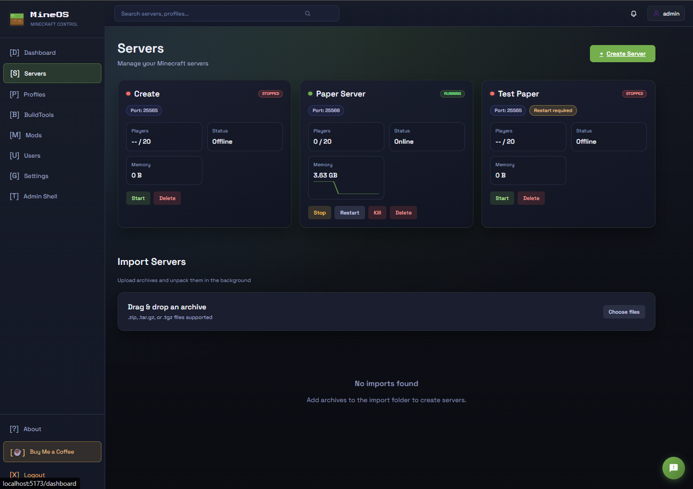
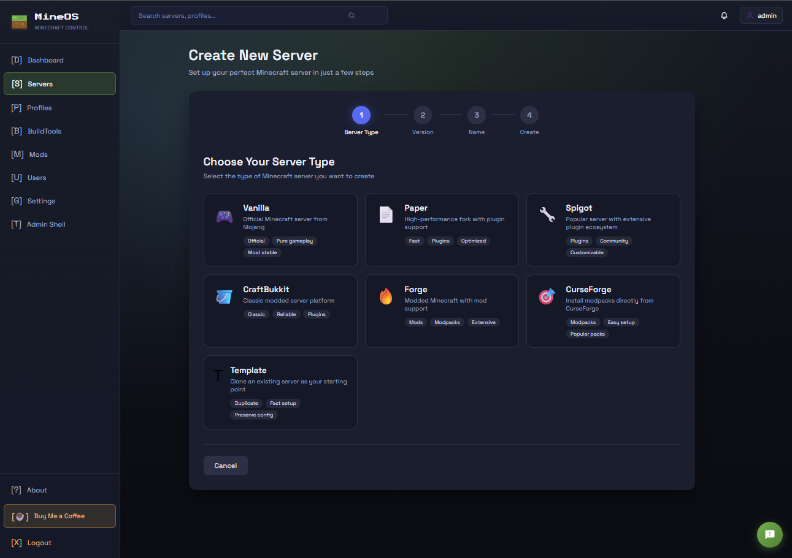
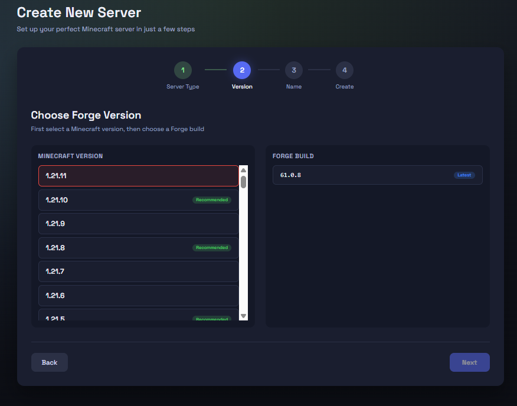
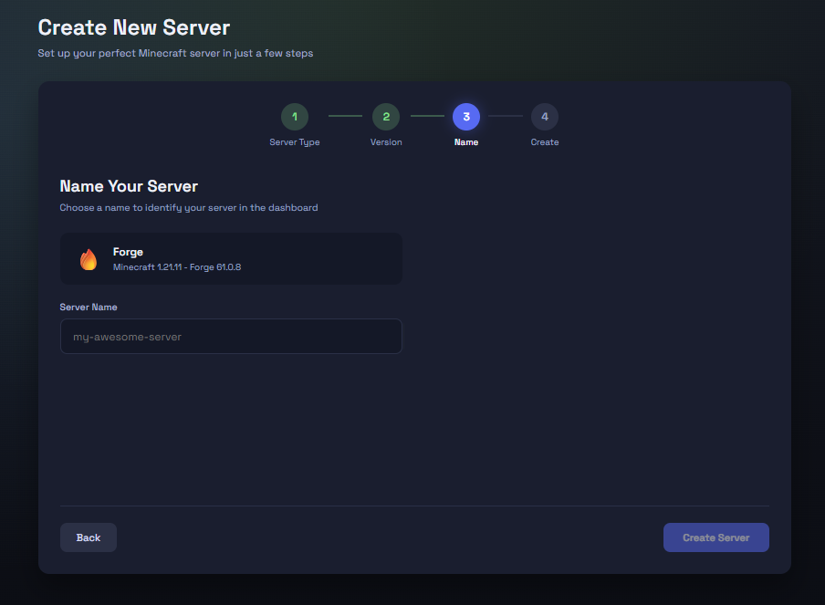
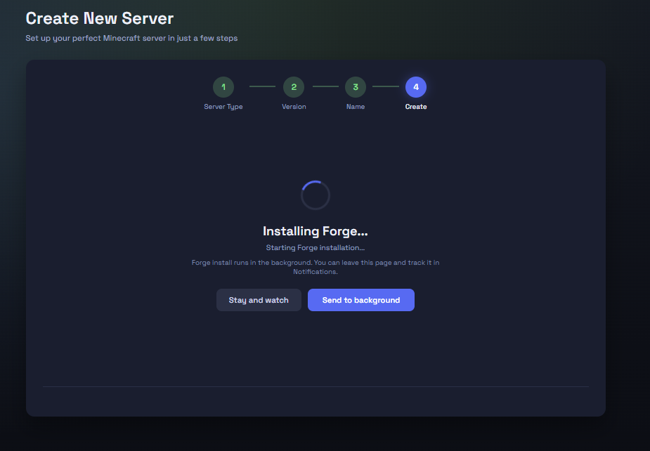
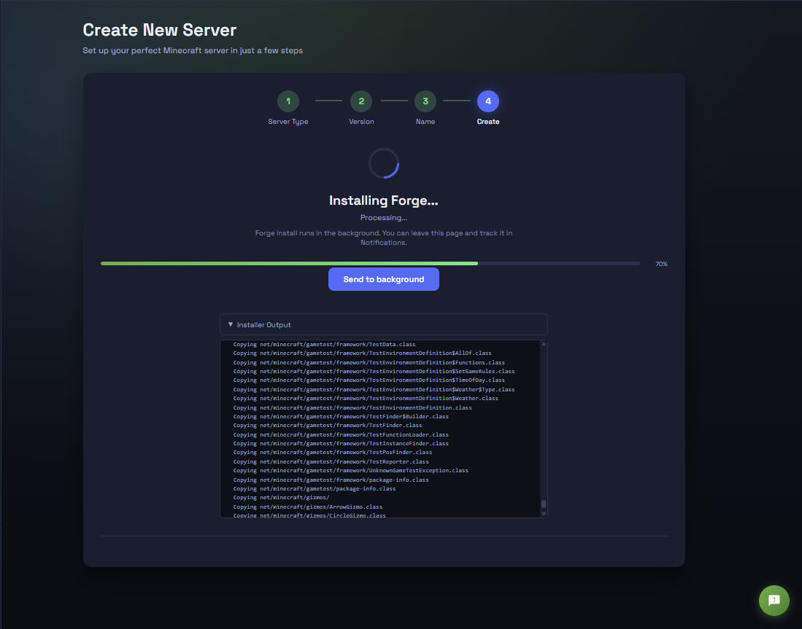
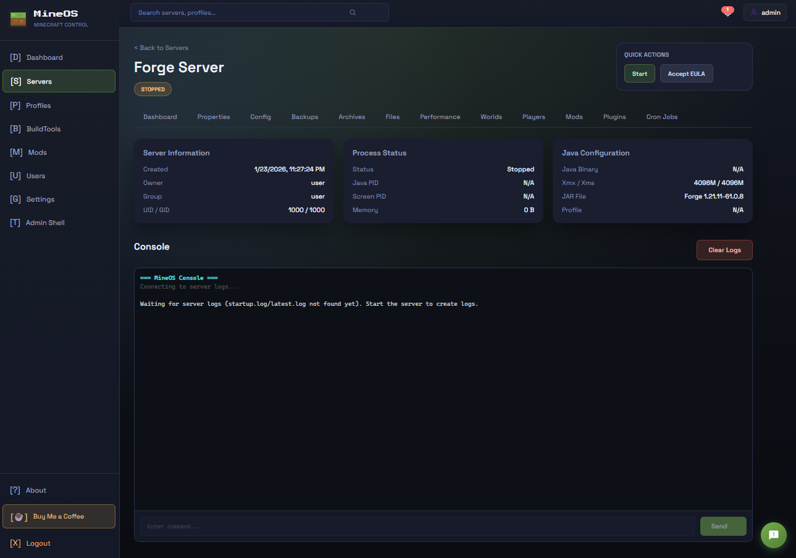

# MineOS - Minecraft Server Manager

> **Version custom Discord.** Elle ajoute des salons multiples,
> des règles par événement et serveur, des modèles de messages et un historique.
> Voir [le guide custom](docs/CUSTOM_DISCORD_FR.md) et [l'installation par lien](docs/INSTALL_LINK_FR.md).
> Installation et gestion avec les fichiers habituels `.env` et `docker-compose.yml`.

## Installation de notre préversion custom

Dépôt : [gauhthierh/mineos-custom-discord](https://github.com/gauhthierh/mineos-custom-discord).
La [préversion validée](https://github.com/gauhthierh/mineos-custom-discord/releases/tag/custom-discord-2026.11.05-preview.3)
est disponible. Installer sur Debian 13 avec :

```bash
curl -fsSL https://raw.githubusercontent.com/GauhthierH/mineos-custom-discord/vibing/install.sh | bash -s -- --preview
```

Le circuit de publication vérifie les tests et le démarrage Linux avant de créer
la release. Voir [les détails de l'installation](docs/INSTALL_LINK_FR.md).

A simple web interface to create and manage Minecraft servers. Run as many servers as you want, install mods with one click, and manage everything from your browser.

## Features

**Servers**
- Create Vanilla, Paper, Spigot, Forge, NeoForge, Fabric, Quilt and Bedrock servers from a guided wizard
- Start/stop/restart, live console, file manager, worlds, players, backups and archives
- Live status, players, memory and TPS, with per-server performance charts
- Scheduled tasks (cron), server icons, changing a server's type after the fact, and renaming servers with a display label
- Update detection with one-click updates (backup + rollback kept) for Vanilla, Paper, Bedrock, Velocity and BungeeCord

**Proxies / networks**
- Run a Velocity or BungeeCord proxy players connect to, with your game servers attached behind it
- Attach a server to a proxy from the create wizard, or from the Proxies page at any time
- Every backend reports a live security status — Secured, Securable, Misconfigured or Unverifiable — so you can see which servers a proxy can actually vouch for, and secure them in one click

**Mods and plugins**
- Browse and install from Modrinth and CurseForge, with dependency resolution
- Per-mod enable/disable, loader version upgrades, and client modpack (`.mrpack`) generation

**Administration**
- Multiple users with roles and per-server access control
- Import existing servers, host metrics, and a `mineos` CLI with a terminal UI

## Installation et gestion

Sur Debian 13, utiliser la commande d'installation ci-dessus. Le dossier par défaut
est `~/mineos`. Le compte initial est `admin` ; son mot de passe aléatoire est dans
`.env`. Ouvrir `http://ADRESSE_DU_DEBIAN:6070` depuis son navigateur.

Pour une installation manuelle depuis nos sources :

```bash
bash scripts/prepare.sh
docker compose up -d --build --wait --wait-timeout 180
```

Les commandes habituelles utilisent directement `docker-compose.yml` et `.env` :

```bash
docker compose ps
docker compose logs --tail=100
docker compose stop
docker compose up -d
```

Les serveurs sont dans `minecraft/`, la base dans `data/`. Modifier `.env` puis
exécuter `docker compose up -d` pour appliquer un changement de port.
Les images sont construites à partir de nos sources et contiennent les fonctions Discord.
Le CLI d'origine n'est pas téléchargé : son mécanisme de mise à jour vise les versions officielles.

Pour passer de la première préversion avec `.env.custom` au format habituel,
consulter [la procédure de migration](docs/CUSTOM_DISCORD_FR.md#migration-des-premières-préversions).

## Screenshots














